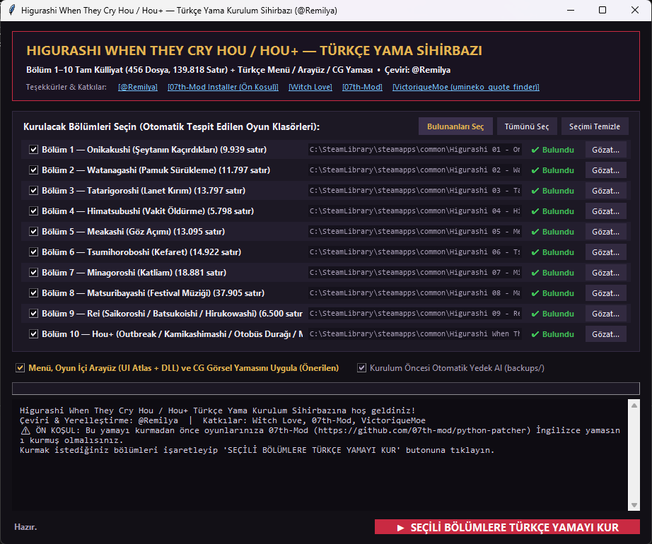
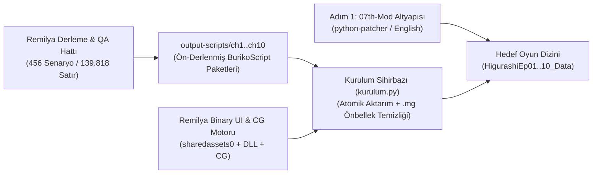

<div align="center">

# 🩸 Higurashi When They Cry Hou / Hou+ 🩸
### Tam Külliyat Türkçe Çeviri, Arayüz (UI) & Görsel (CG) Yerelleştirme Projesi

[](https://github.com/Remilya)
[-2b8a3e?style=for-the-badge)](https://github.com/Remilya/Higurashi)
[](https://github.com/Remilya/Higurashi)
[](https://github.com/Remilya/Higurashi)
[-7048e8?style=for-the-badge)](https://github.com/07th-mod/python-patcher)

---

> *"Haziran 1983. Cırcır böceklerinin (higurashi) yankılanan sesi eşliğinde,*  
> *Hinamizawa köyünün trajedisi, gizemi ve mucizesi artık 10 bölümün tamamıyla Türkçe..."*

</div>

## 🌟 Proje Hakkında

Bu proje, **07th-Mod** yamalı **Higurashi When They Cry Hou** ve **Hou+** külliyatının tamamını (**Bölüm 1 – Bölüm 10**, toplam **456 senaryo dosyası** ve **139.818 diyalog satırı**) edebi ve karakter ruhuna sadık bir Türkçeyle sunan; bununla birlikte oyun içi **Unity NGUI doku atlaslarını (`sharedassets0.assets`)**, **`MonoBehaviour` etiketlerini**, **`Assembly-CSharp.dll` sistem dizelerini** ve **`StreamingAssets/CG` görsellerini** tamamen Türkçeleştiren kapsamlı bir yerelleştirme ve araç setidir.

---

## 🏆 Emeği Geçenler & Özel Teşekkürler (Credits)

| Rol / Katkı | İsim / Proje | Bağlantı |
| :--- | :--- | :--- |
| **Baş Çevirmen, Külliyat (Ch.1–10), UI/CG Yerelleştirme & Araç Seti** | **@Remilya** | [github.com/Remilya/Higurashi](https://github.com/Remilya/Higurashi) |
| **Orijinal Açık Kaynak Altyapısı & İlk Bölüm Katkıları** | **Witch Love** | [github.com/Witch-Love/higurashi-scripting-tr](https://github.com/Witch-Love/higurashi-scripting-tr) |
| **Seslendirme, Konsol Grafikleri & Çok Dilli Motor Altyapısı** | **07th-Mod** | [github.com/07th-mod](https://github.com/07th-mod) / [python-patcher](https://github.com/07th-mod/python-patcher) |
| **Alıntı Arama Motoru & Veritabanı Mimarisi İlhamı** | **VictoriqueMoe** (*umineko_quote_finder*) | [github.com/VictoriqueMoe/umineko_quote_finder](https://github.com/VictoriqueMoe/umineko_quote_finder) |

> **[@Remilya](https://github.com/Remilya)** tarafından çevrilmiş ve tamamlanmıştır. **[Witch Love](https://github.com/Witch-Love/higurashi-scripting-tr)** ekibine, **[07th-Mod](https://github.com/07th-mod)** geliştiricilerine ve **[VictoriqueMoe (`umineko_quote_finder`)](https://github.com/VictoriqueMoe/umineko_quote_finder)**'ya değerli emekleri ve açık kaynak katkıları için sonsuz teşekkürler!

---

## 🪄 Adım Adım Kurulum Rehberi (07th-Mod + Türkçe Yama Sihirbazı)

> [!IMPORTANT]
> **ÖN KOŞUL (Adım 1 — 07th-Mod Kurulumu):**  
> Bu Türkçe yama, **07th-Mod** altyapısı (`StreamingAssets/Update/`, konsol grafikleri, seslendirmeler ve gelişmiş NGUI menü sistemi) üzerine kurulmaktadır.  
> Türkçe yamayı kurmadan önce, temiz (Steam/GOG/MangaGamer) oyunlarınıza **[07th-Mod Python Patcher (`github.com/07th-mod/python-patcher`)](https://github.com/07th-mod/python-patcher)** aracını kullanarak **standart İngilizce 07th-Mod yamasını** kurmuş olmanız gerekmektedir.

### Adım 1: 07th-Mod (İngilizce + Ses & Grafik Yaması) Kurulumu
1. **[07th-Mod Kurulum Aracını (`python-patcher`)](https://github.com/07th-mod/python-patcher)** indirin ve çalıştırın.
2. Kurmak istediğiniz Higurashi bölümünü/bölümlerini (Ch.1 *Onikakushi* – Ch.10 *Hou+*) seçin ve **İngilizce (English)** dil seçeneğiyle 07th-Mod kurulumunu tamamlayın.

### Adım 2: Higurashi Türkçe Yama Kurulum Sihirbazı (`kurulum.bat`)
07th-Mod kurulumunu tamamladıktan sonra projede yer alan **Higurashi Türkçe Yama Kurulum Sihirbazı**, bilgisayarınızdaki Higurashi bölümlerini otomatik olarak tespit eder; istediğiniz bölümleri seçip **tek tıkla** hem senaryo çevirilerini hem de Türkçe menü/arayüz/CG yamasını kurmanızı sağlar.

#### A) Grafiksel Kurulum Sihirbazı (GUI — Önerilen)
Ana dizindeki **`kurulum.bat`** dosyasına çift tıklayın veya terminalden şu komutu çalıştırın:
```bash
python kurulum.py
```

<div align="center">
  
</div>

- **Bölüm Seçimi:** Bölüm 1'den Bölüm 10'a (*Hou+*) kadar istediğiniz bölümleri işaretleyin veya **Bulunanları Seç** butonuna tıklayın.
- **07th-Mod Kontrolü:** Seçilen oyun klasöründe 07th-Mod (`StreamingAssets/Update`) kurulu olup olmadığını otomatik denetler.
- **Menü & Arayüz Yaması:** `sharedassets0.assets` doku atlaslarını, `MonoBehaviour` etiketlerini ve `Assembly-CSharp.dll` dizelerini otomatik olarak Türkçeleştirir.
- **Otomatik Yedekleme & Önbellek Temizliği:** Kurulum öncesi `backups/` altında yedek alır ve oyunun yeni çevirileri anında derlemesi için `.mg` önbellek dosyalarını temizler.

#### B) Etkileşimli Terminal Sihirbazı (CLI)
```bash
python kurulum.py --cli
```
```text
╔══════════════════════════════════════════════════════════════════════════╗
║     HIGURASHI WHEN THEY CRY HOU / HOU+ — TÜRKÇE YAMA KURULUM SİHİRBAZI   ║
║                     Çeviri & Yerelleştirme: @Remilya                     ║
╠══════════════════════════════════════════════════════════════════════════╣
║  ⚠ ÖN KOŞUL: Türkçe yamayı kurmadan önce oyunlarınıza 07th-Mod           ║
║    (İngilizce) yamasını kurmuş olmanız gerekmektedir:                    ║
║    -> https://github.com/07th-mod/python-patcher                         ║
╠══════════════════════════════════════════════════════════════════════════╣
║  Özel Teşekkürler:                                                       ║
║   • Witch Love    (github.com/Witch-Love/higurashi-scripting-tr)         ║
║   • 07th-Mod      (github.com/07th-mod)                                  ║
║   • VictoriqueMoe (github.com/VictoriqueMoe/umineko_quote_finder)        ║
╚══════════════════════════════════════════════════════════════════════════╝

  [ 1] Bölüm 1 — Onikakushi (Şeytanın Kaçırdıkları)        | ✔ Bulundu
  ...
  [10] Bölüm 10 — Hou+ (Outbreak / Kamikashimashi / ...)   | ✔ Bulundu
  [A]  Bulunan Tüm Bölümleri Kur (1–10)
```

---

## 📊 Külliyat Genel İlerleme Tablosu (Bölüm 1–10)

| Bölüm | Ark Adı | Türkçe Adı / İçerik | Kategori | Dosya | Satır Sayısı | Arayüz & CG | Durum |
| :---: | :--- | :--- | :---: | :---: | :---: | :---: | :---: |
| **Ch.1** | **Onikakushi** | *Şeytanın Kaçırdıkları* | Soru Arkı 1 | 39 | 9.939 | ✅ Tam | **%100.0 ✅** |
| **Ch.2** | **Watanagashi** | *Pamuk Sürükleme* | Soru Arkı 2 | 46 | 11.797 | ✅ Tam | **%100.0 ✅** |
| **Ch.3** | **Tatarigoroshi** | *Lanet Kırım* | Soru Arkı 3 | 42 | 13.797 | ✅ Tam | **%100.0 ✅** |
| **Ch.4** | **Himatsubushi** | *Vakit Öldürme* | Soru Arkı 4 | 27 | 5.798 | ✅ Tam | **%100.0 ✅** |
| **Ch.5** | **Meakashi** | *Göz Açımı* | Cevap Arkı 1 | 60 | 13.095 | ✅ Tam | **%100.0 ✅** |
| **Ch.6** | **Tsumihoroboshi** | *Kefaret* | Cevap Arkı 2 | 54 | 14.922 | ✅ Tam | **%100.0 ✅** |
| **Ch.7** | **Minagoroshi** | *Katliam* | Cevap Arkı 3 | 51 | 18.881 | ✅ Tam | **%100.0 ✅** |
| **Ch.8** | **Matsuribayashi** | *Festival Müziği* | Final Cevap Arkı | 81 | 37.905 | ✅ Tam | **%100.0 ✅** |
| **Ch.9** | **Rei** | *Saikoroshi / Batsukoishi / Hirukowashi* | Fandisc / Epilog | 42 | 6.500 | ✅ Tam | **%100.0 ✅** |
| **Ch.10** | **Hou+** | *Outbreak / Kamikashimashi / Otobüs Durağı / Mehagashi* | Bonus & Prototip Külliyatı | 14 | 7.184 | ✅ Tam | **%100.0 ✅** |
| **TOPLAM** | **Tüm Seri (Ch.1–10)** | **Tam Külliyat** | **10 Oyun** | **456** | **139.818** | **✅ Tam** | **%100.0 ✅** |

---

## ⚙️ Teknik Mimari & Yerelleştirme Sistemi (*Remilya Engine*)

Bu yama, sıradan bir metin değişiminin ötesinde; **BGIM / BurikoScript sanal makinesi**, **Unity NGUI / TextMeshPro varlık serileştirmesi** ve **139.818 satırlık bağlam duyarlı çeviri doğrulama hattı** üzerinde çalışan özel bir mühendislik altyapısıyla üretilmiştir:



### 1. BurikoScript AST & Dinamik Sansür Dallanması (`vm00` / `vm0x`) Senkronizasyonu
- **07th-Mod Ses Eşleştirme & Sansür Dalları:** Oyun motoru, `GCensor` ve `GVoiceMatching` bayraklarına göre çalışma zamanında `ModCallScriptSection` üzerinden `z*_vm00_n01` (PC orijinal/sansürsüz) ve `z*_vm0x_n01` (PS3/Switch konsol revizyonu) alt rutinlerine dallanır. Derleme hattımız, ana senaryo ile tüm alt rutin fonksiyon gövdelerini birebir hizalayarak hangi ses eşleştirme seviyesi (0–5) seçilirse seçilsin **sıfır İngilizce satır kalmasını** ve **PS3 dudak senkronunun (lip-sync) korunmasını** sağlar.
- **Satır İçi ve Çoklu Konuşmacı Etiketleri:** Standart `NULL` anlatıcı bloklarının yanı sıra satır içi `<color=#...>` ve `<size=..>` konuşmacı etiketlerini, aynı anda konuşan ikili/üçlü karakter kombinasyonlarını ve `Select()` seçim dizilerini (Ch.8 *Kakera* & Ch.9 *Hirukowashi* dalları dahil) motorun kontrol bayraklarını (`Line_Normal`, `Line_WaitForInput`, `Line_ContinueAfterTyping`) bozmadan derler.

### 2. Unity İkili Varlık (`sharedassets0.assets`), NGUI Atlas & `.NET` CIL (`#US`) Yaması
- **Unity Serileştirme & `script_type_index` Korunumu:** Bölüm 1–10 arasındaki farklı Unity motor sürümlerinde (Unity 5.x – 2019.x) `ObjectReader` ikili başlık yapısı korunarak `Texture2D` doku atlasları (`TitleHigurashi`, `ConfigHigurashi`, `ChapterJump`, `ChapterPreview`, `FragmentList`, `SGMenu`, `TipsPrefab`) ve `UIAtlas` / `UILocalize` / `TextMeshPro` `MonoBehaviour` bileşenleri doğrudan ikili düzeyde yeniden paketlenmiştir.
- **Türkçe Glif & SDF Font Yönlendirmesi:** Oyun içi `msgothic_0 SDF` ve `LiberationSans SDF` işaretçileri Türkçe karakter kümesini (`ğ, ü, ş, ı, ö, ç, İ, Ğ, Ü, Ş, Ö, Ç`) tam destekleyen SDF font varlıklarına yönlendirilmiş; `.NET` `Assembly-CSharp.dll` içerisindeki `#US` (User Strings) UTF-16LE yığını bayt hizalaması korunarak Türkçeleştirilmiştir.

### 3. Bağlam Duyarlı Terminoloji, Hitap & Karakter Ses Tonu Motoru
- **139.818 Satırlık Çapraz Referanslı Külliyat:** *VictoriqueMoe*'nun *umineko_quote_finder* mimarisinden ilham alan tam metin indeksleme (SQLite FTS5) ve terim sözlüğü altyapısı sayesinde; *Oyashiro-sama*, *Watanagashi*, *Hinamizawa Sendromu (Seviye 1–5)*, *Üç Büyük Aile*, *Tokyo*, *Bölüm 48*, *Hifumi Takano* belgeleri ve 52 *Kakera* boyunca %100 terim tutarlılığı sağlanmıştır.
- **Karakter İmzaları ve Arkaik Lehçeler:** Rika'nın *«~nano desu / Mii / Nipah~☆»* ifadeleri, Hanyuu'nun *«Auau~»* tınısı, Mion'un *«amca (ojii-chan)»* üslubu, Satoko'nun kibirli *«~wa / Ohohoho!»* konuşma tarzı, *Kamikashimashi-hen*'de **Tamurahime-no-Mikoto**'nun arkaik tanrıça dili ve *Hinamizawa Otobüs Durağı* tiyatro prototipindeki Rika–Mion (*senpai–kouhai*) hiyerarşisi sadakatle korunmuştur.

### 4. Otomatik ANTLR3 (`.mg`) Bayt Kodu Önbellek Geçersiz Kılma
- Oyun motoru, `StreamingAssets/Update/*.txt` senaryolarını ilk çalıştırmada ANTLR3 tabanlı ikili `.mg` bayt koduna derleyerek `CompiledUpdateScripts/` altında önbelleğe alır. Kurulum sihirbazı (`kurulum.py`), atomik dosya aktarımının ardından eski `.mg` önbelleğini ve `txtInfoDictionary` indekslerini otomatik olarak temizleyerek oyunun açılışta yeni Türkçe senaryoları hatasız derlemesini garanti eder.

---

## 💻 Hızlı Kurulum Komutları (`kurulum.bat` / `kurulum.py`)

```bash
# Grafiksel Kurulum Sihirbazını (GUI) başlat (veya doğrudan kurulum.bat'a çift tıklayın):
kurulum.bat
python kurulum.py

# Etkileşimli Terminal Sihirbazını (CLI) başlat:
python kurulum.py --cli

# Bilgisayarda tespit edilen tüm bölümlere (1–10) tek komutla kur:
python kurulum.py --all

# Belirli bir bölümü (örn. Bölüm 10 — Hou+) kur:
python kurulum.py --chapter 10
```

---

## 📂 Bölüm ve Dosya Bazlı İlerleme (456/456 Dosya ✅)

* <details>
  <summary><b>Chapter 1 — Onikakushi (Şeytanın Kaçırdıkları)</b> • 39/39 Dosya (9.939 Satır) ✅</summary>

   * **Story**
      * [onik_000](output-scripts/ch1/onik_000.txt) ✅
      * [onik_001](output-scripts/ch1/onik_001.txt) ✅
      * [onik_002](output-scripts/ch1/onik_002.txt) ✅
      * [onik_003](output-scripts/ch1/onik_003.txt) ✅
      * [onik_004](output-scripts/ch1/onik_004.txt) ✅
      * [onik_005](output-scripts/ch1/onik_005.txt) ✅
      * [onik_009](output-scripts/ch1/onik_009.txt) ✅
      * [onik_009_02](output-scripts/ch1/onik_009_02.txt) ✅
      * [onik_010](output-scripts/ch1/onik_010.txt) ✅
      * [onik_011](output-scripts/ch1/onik_011.txt) ✅
      * [onik_012](output-scripts/ch1/onik_012.txt) ✅
      * [onik_013](output-scripts/ch1/onik_013.txt) ✅
      * [onik_014](output-scripts/ch1/onik_014.txt) ✅
      * [onik_014_02](output-scripts/ch1/onik_014_02.txt) ✅
      * [onik_015](output-scripts/ch1/onik_015.txt) ✅
      * [onik_015_02](output-scripts/ch1/onik_015_02.txt) ✅
      * [onik_015_03](output-scripts/ch1/onik_015_03.txt) ✅
      * [onik_op](output-scripts/ch1/onik_op.txt) ✅
   * **Tips**
      * [onik_tips_01](output-scripts/ch1/onik_tips_01.txt) ✅
      * [onik_tips_02](output-scripts/ch1/onik_tips_02.txt) ✅
      * [onik_tips_03](output-scripts/ch1/onik_tips_03.txt) ✅
      * [onik_tips_04](output-scripts/ch1/onik_tips_04.txt) ✅
      * [onik_tips_05](output-scripts/ch1/onik_tips_05.txt) ✅
      * [onik_tips_06](output-scripts/ch1/onik_tips_06.txt) ✅
      * [onik_tips_07](output-scripts/ch1/onik_tips_07.txt) ✅
      * [onik_tips_08](output-scripts/ch1/onik_tips_08.txt) ✅
      * [onik_tips_09](output-scripts/ch1/onik_tips_09.txt) ✅
      * [onik_tips_10](output-scripts/ch1/onik_tips_10.txt) ✅
      * [onik_tips_11](output-scripts/ch1/onik_tips_11.txt) ✅
      * [onik_tips_12](output-scripts/ch1/onik_tips_12.txt) ✅
      * [onik_tips_13](output-scripts/ch1/onik_tips_13.txt) ✅
      * [onik_tips_14](output-scripts/ch1/onik_tips_14.txt) ✅
      * [onik_tips_15](output-scripts/ch1/onik_tips_15.txt) ✅
      * [onik_tips_16](output-scripts/ch1/onik_tips_16.txt) ✅
      * [onik_tips_17](output-scripts/ch1/onik_tips_17.txt) ✅
      * [onik_tips_18](output-scripts/ch1/onik_tips_18.txt) ✅
      * [onik_tips_19](output-scripts/ch1/onik_tips_19.txt) ✅
      * [onik_tips_20](output-scripts/ch1/onik_tips_20.txt) ✅
   * **Extras / Other**
      * [omake_01](output-scripts/ch1/omake_01.txt) ✅
  </details>
* <details>
  <summary><b>Chapter 2 — Watanagashi (Pamuk Sürükleme)</b> • 46/46 Dosya (11.797 Satır) ✅</summary>

   * **Story**
      * [wata_001](output-scripts/ch2/wata_001.txt) ✅
      * [wata_002](output-scripts/ch2/wata_002.txt) ✅
      * [wata_003](output-scripts/ch2/wata_003.txt) ✅
      * [wata_004](output-scripts/ch2/wata_004.txt) ✅
      * [wata_005](output-scripts/ch2/wata_005.txt) ✅
      * [wata_006](output-scripts/ch2/wata_006.txt) ✅
      * [wata_007](output-scripts/ch2/wata_007.txt) ✅
      * [wata_008](output-scripts/ch2/wata_008.txt) ✅
      * [wata_009](output-scripts/ch2/wata_009.txt) ✅
      * [wata_009_02](output-scripts/ch2/wata_009_02.txt) ✅
      * [wata_010](output-scripts/ch2/wata_010.txt) ✅
      * [wata_010_02](output-scripts/ch2/wata_010_02.txt) ✅
      * [wata_010_03](output-scripts/ch2/wata_010_03.txt) ✅
      * [wata_010_04](output-scripts/ch2/wata_010_04.txt) ✅
      * [wata_011](output-scripts/ch2/wata_011.txt) ✅
      * [wata_011_02](output-scripts/ch2/wata_011_02.txt) ✅
      * [wata_012](output-scripts/ch2/wata_012.txt) ✅
      * [wata_012_02](output-scripts/ch2/wata_012_02.txt) ✅
      * [wata_012_03](output-scripts/ch2/wata_012_03.txt) ✅
   * **Tips**
      * [wata_tips_01](output-scripts/ch2/wata_tips_01.txt) ✅
      * [wata_tips_02](output-scripts/ch2/wata_tips_02.txt) ✅
      * [wata_tips_03](output-scripts/ch2/wata_tips_03.txt) ✅
      * [wata_tips_04](output-scripts/ch2/wata_tips_04.txt) ✅
      * [wata_tips_05](output-scripts/ch2/wata_tips_05.txt) ✅
      * [wata_tips_06](output-scripts/ch2/wata_tips_06.txt) ✅
      * [wata_tips_07](output-scripts/ch2/wata_tips_07.txt) ✅
      * [wata_tips_08](output-scripts/ch2/wata_tips_08.txt) ✅
      * [wata_tips_09](output-scripts/ch2/wata_tips_09.txt) ✅
      * [wata_tips_10](output-scripts/ch2/wata_tips_10.txt) ✅
      * [wata_tips_11](output-scripts/ch2/wata_tips_11.txt) ✅
      * [wata_tips_12](output-scripts/ch2/wata_tips_12.txt) ✅
      * [wata_tips_13](output-scripts/ch2/wata_tips_13.txt) ✅
      * [wata_tips_14](output-scripts/ch2/wata_tips_14.txt) ✅
      * [wata_tips_15](output-scripts/ch2/wata_tips_15.txt) ✅
      * [wata_tips_16](output-scripts/ch2/wata_tips_16.txt) ✅
      * [wata_tips_17](output-scripts/ch2/wata_tips_17.txt) ✅
      * [wata_tips_18](output-scripts/ch2/wata_tips_18.txt) ✅
      * [wata_tips_19](output-scripts/ch2/wata_tips_19.txt) ✅
      * [wata_tips_20](output-scripts/ch2/wata_tips_20.txt) ✅
      * [wata_tips_21](output-scripts/ch2/wata_tips_21.txt) ✅
      * [wata_tips_22](output-scripts/ch2/wata_tips_22.txt) ✅
      * [wata_tips_23](output-scripts/ch2/wata_tips_23.txt) ✅
      * [wata_tips_24](output-scripts/ch2/wata_tips_24.txt) ✅
   * **Extras / Other**
      * [omake_02](output-scripts/ch2/omake_02.txt) ✅
      * [wata_ep_01](output-scripts/ch2/wata_ep_01.txt) ✅
      * [wata_ep_02](output-scripts/ch2/wata_ep_02.txt) ✅
  </details>
* <details>
  <summary><b>Chapter 3 — Tatarigoroshi (Lanet Kırım)</b> • 42/42 Dosya (13.797 Satır) ✅</summary>

   * **Story**
      * [tata_001](output-scripts/ch3/tata_001.txt) ✅
      * [tata_002](output-scripts/ch3/tata_002.txt) ✅
      * [tata_003](output-scripts/ch3/tata_003.txt) ✅
      * [tata_004](output-scripts/ch3/tata_004.txt) ✅
      * [tata_005](output-scripts/ch3/tata_005.txt) ✅
      * [tata_008](output-scripts/ch3/tata_008.txt) ✅
      * [tata_008_02](output-scripts/ch3/tata_008_02.txt) ✅
      * [tata_009](output-scripts/ch3/tata_009.txt) ✅
      * [tata_009_02](output-scripts/ch3/tata_009_02.txt) ✅
      * [tata_010](output-scripts/ch3/tata_010.txt) ✅
      * [tata_010_02](output-scripts/ch3/tata_010_02.txt) ✅
      * [tata_010_03](output-scripts/ch3/tata_010_03.txt) ✅
      * [tata_010_04](output-scripts/ch3/tata_010_04.txt) ✅
      * [tata_011](output-scripts/ch3/tata_011.txt) ✅
      * [tata_011_02](output-scripts/ch3/tata_011_02.txt) ✅
      * [tata_011_03](output-scripts/ch3/tata_011_03.txt) ✅
      * [tata_012](output-scripts/ch3/tata_012.txt) ✅
      * [tata_013](output-scripts/ch3/tata_013.txt) ✅
      * [tata_013_02](output-scripts/ch3/tata_013_02.txt) ✅
      * [tata_014](output-scripts/ch3/tata_014.txt) ✅
   * **Tips**
      * [tata_tips_01](output-scripts/ch3/tata_tips_01.txt) ✅
      * [tata_tips_02](output-scripts/ch3/tata_tips_02.txt) ✅
      * [tata_tips_03](output-scripts/ch3/tata_tips_03.txt) ✅
      * [tata_tips_04](output-scripts/ch3/tata_tips_04.txt) ✅
      * [tata_tips_05](output-scripts/ch3/tata_tips_05.txt) ✅
      * [tata_tips_06](output-scripts/ch3/tata_tips_06.txt) ✅
      * [tata_tips_07](output-scripts/ch3/tata_tips_07.txt) ✅
      * [tata_tips_08](output-scripts/ch3/tata_tips_08.txt) ✅
      * [tata_tips_09](output-scripts/ch3/tata_tips_09.txt) ✅
      * [tata_tips_10](output-scripts/ch3/tata_tips_10.txt) ✅
      * [tata_tips_11](output-scripts/ch3/tata_tips_11.txt) ✅
      * [tata_tips_12](output-scripts/ch3/tata_tips_12.txt) ✅
      * [tata_tips_13](output-scripts/ch3/tata_tips_13.txt) ✅
      * [tata_tips_14](output-scripts/ch3/tata_tips_14.txt) ✅
      * [tata_tips_15](output-scripts/ch3/tata_tips_15.txt) ✅
      * [tata_tips_16](output-scripts/ch3/tata_tips_16.txt) ✅
      * [tata_tips_17](output-scripts/ch3/tata_tips_17.txt) ✅
      * [tata_tips_18](output-scripts/ch3/tata_tips_18.txt) ✅
      * [tata_tips_19](output-scripts/ch3/tata_tips_19.txt) ✅
   * **Extras / Other**
      * [omake_03](output-scripts/ch3/omake_03.txt) ✅
      * [tata_ep01](output-scripts/ch3/tata_ep01.txt) ✅
      * [tata_ep02](output-scripts/ch3/tata_ep02.txt) ✅
  </details>
* <details>
  <summary><b>Chapter 4 — Himatsubushi (Vakit Öldürme)</b> • 27/27 Dosya (5.798 Satır) ✅</summary>

   * **Story**
      * [hima_001](output-scripts/ch4/hima_001.txt) ✅
      * [hima_002](output-scripts/ch4/hima_002.txt) ✅
      * [hima_002_02](output-scripts/ch4/hima_002_02.txt) ✅
      * [hima_002_03](output-scripts/ch4/hima_002_03.txt) ✅
      * [hima_003](output-scripts/ch4/hima_003.txt) ✅
      * [hima_003_02](output-scripts/ch4/hima_003_02.txt) ✅
      * [hima_003_03](output-scripts/ch4/hima_003_03.txt) ✅
      * [hima_003_03a](output-scripts/ch4/hima_003_03a.txt) ✅
      * [hima_003_04](output-scripts/ch4/hima_003_04.txt) ✅
      * [hima_003_05](output-scripts/ch4/hima_003_05.txt) ✅
      * [hima_004](output-scripts/ch4/hima_004.txt) ✅
   * **Tips**
      * [hima_tips_01](output-scripts/ch4/hima_tips_01.txt) ✅
      * [hima_tips_02](output-scripts/ch4/hima_tips_02.txt) ✅
      * [hima_tips_03](output-scripts/ch4/hima_tips_03.txt) ✅
      * [hima_tips_04](output-scripts/ch4/hima_tips_04.txt) ✅
      * [hima_tips_05](output-scripts/ch4/hima_tips_05.txt) ✅
      * [hima_tips_06](output-scripts/ch4/hima_tips_06.txt) ✅
      * [hima_tips_07](output-scripts/ch4/hima_tips_07.txt) ✅
      * [hima_tips_08](output-scripts/ch4/hima_tips_08.txt) ✅
      * [hima_tips_09](output-scripts/ch4/hima_tips_09.txt) ✅
      * [hima_tips_10](output-scripts/ch4/hima_tips_10.txt) ✅
      * [hima_tips_11](output-scripts/ch4/hima_tips_11.txt) ✅
      * [hima_tips_12](output-scripts/ch4/hima_tips_12.txt) ✅
      * [hima_tips_13](output-scripts/ch4/hima_tips_13.txt) ✅
      * [hima_tips_14](output-scripts/ch4/hima_tips_14.txt) ✅
   * **Extras / Other**
      * [hima_badend](output-scripts/ch4/hima_badend.txt) ✅
      * [omake_04](output-scripts/ch4/omake_04.txt) ✅
  </details>
* <details>
  <summary><b>Chapter 5 — Meakashi (Göz Açımı)</b> • 60/60 Dosya (13.095 Satır) ✅</summary>

   * **Story**
      * [_meak_001](output-scripts/ch5/_meak_001.txt) ✅
      * [_meak_002](output-scripts/ch5/_meak_002.txt) ✅
      * [_meak_003](output-scripts/ch5/_meak_003.txt) ✅
      * [_meak_004](output-scripts/ch5/_meak_004.txt) ✅
      * [_meak_005](output-scripts/ch5/_meak_005.txt) ✅
      * [_meak_006](output-scripts/ch5/_meak_006.txt) ✅
      * [_meak_007](output-scripts/ch5/_meak_007.txt) ✅
      * [_meak_008](output-scripts/ch5/_meak_008.txt) ✅
      * [_meak_009](output-scripts/ch5/_meak_009.txt) ✅
      * [_meak_010](output-scripts/ch5/_meak_010.txt) ✅
      * [_meak_011](output-scripts/ch5/_meak_011.txt) ✅
      * [_meak_012](output-scripts/ch5/_meak_012.txt) ✅
      * [_meak_013](output-scripts/ch5/_meak_013.txt) ✅
      * [_meak_014_1](output-scripts/ch5/_meak_014_1.txt) ✅
      * [_meak_014_2](output-scripts/ch5/_meak_014_2.txt) ✅
      * [_meak_015_1](output-scripts/ch5/_meak_015_1.txt) ✅
      * [_meak_015_2](output-scripts/ch5/_meak_015_2.txt) ✅
      * [_meak_016_1](output-scripts/ch5/_meak_016_1.txt) ✅
      * [_meak_016_2](output-scripts/ch5/_meak_016_2.txt) ✅
      * [_meak_017](output-scripts/ch5/_meak_017.txt) ✅
      * [_meak_018](output-scripts/ch5/_meak_018.txt) ✅
      * [_meak_019_1](output-scripts/ch5/_meak_019_1.txt) ✅
      * [_meak_019_2](output-scripts/ch5/_meak_019_2.txt) ✅
      * [_meak_020](output-scripts/ch5/_meak_020.txt) ✅
      * [_meak_021_1](output-scripts/ch5/_meak_021_1.txt) ✅
      * [_meak_021_2](output-scripts/ch5/_meak_021_2.txt) ✅
      * [_meak_022_1](output-scripts/ch5/_meak_022_1.txt) ✅
      * [_meak_022_2](output-scripts/ch5/_meak_022_2.txt) ✅
      * [_meak_023](output-scripts/ch5/_meak_023.txt) ✅
      * [_meak_024](output-scripts/ch5/_meak_024.txt) ✅
      * [_meak_024a](output-scripts/ch5/_meak_024a.txt) ✅
      * [_meak_024b](output-scripts/ch5/_meak_024b.txt) ✅
   * **Tips**
      * [_meak_tips_01](output-scripts/ch5/_meak_tips_01.txt) ✅
      * [_meak_tips_02](output-scripts/ch5/_meak_tips_02.txt) ✅
      * [_meak_tips_03](output-scripts/ch5/_meak_tips_03.txt) ✅
      * [_meak_tips_04](output-scripts/ch5/_meak_tips_04.txt) ✅
      * [_meak_tips_05](output-scripts/ch5/_meak_tips_05.txt) ✅
      * [_meak_tips_06](output-scripts/ch5/_meak_tips_06.txt) ✅
      * [_meak_tips_07](output-scripts/ch5/_meak_tips_07.txt) ✅
      * [_meak_tips_08](output-scripts/ch5/_meak_tips_08.txt) ✅
      * [_meak_tips_09](output-scripts/ch5/_meak_tips_09.txt) ✅
      * [_meak_tips_10](output-scripts/ch5/_meak_tips_10.txt) ✅
      * [_meak_tips_11](output-scripts/ch5/_meak_tips_11.txt) ✅
      * [_meak_tips_12](output-scripts/ch5/_meak_tips_12.txt) ✅
      * [_meak_tips_13](output-scripts/ch5/_meak_tips_13.txt) ✅
      * [_meak_tips_14](output-scripts/ch5/_meak_tips_14.txt) ✅
      * [_meak_tips_15](output-scripts/ch5/_meak_tips_15.txt) ✅
      * [_meak_tips_16](output-scripts/ch5/_meak_tips_16.txt) ✅
      * [_meak_tips_17](output-scripts/ch5/_meak_tips_17.txt) ✅
      * [_meak_tips_18](output-scripts/ch5/_meak_tips_18.txt) ✅
      * [_meak_tips_19](output-scripts/ch5/_meak_tips_19.txt) ✅
      * [_meak_tips_20](output-scripts/ch5/_meak_tips_20.txt) ✅
      * [_meak_tips_21](output-scripts/ch5/_meak_tips_21.txt) ✅
      * [_meak_tips_22](output-scripts/ch5/_meak_tips_22.txt) ✅
      * [_meak_tips_23](output-scripts/ch5/_meak_tips_23.txt) ✅
   * **Extras / Other**
      * [_meak_badend](output-scripts/ch5/_meak_badend.txt) ✅
      * [_meak_ep_01](output-scripts/ch5/_meak_ep_01.txt) ✅
      * [_meak_ep_02](output-scripts/ch5/_meak_ep_02.txt) ✅
      * [_meak_ep_03](output-scripts/ch5/_meak_ep_03.txt) ✅
      * [staffroom](output-scripts/ch5/staffroom.txt) ✅
  </details>
* <details>
  <summary><b>Chapter 6 — Tsumihoroboshi (Kefaret)</b> • 54/54 Dosya (14.922 Satır) ✅</summary>

   * **Story**
      * [_tsum_001](output-scripts/ch6/_tsum_001.txt) ✅
      * [_tsum_002_1](output-scripts/ch6/_tsum_002_1.txt) ✅
      * [_tsum_002_2](output-scripts/ch6/_tsum_002_2.txt) ✅
      * [_tsum_003_1](output-scripts/ch6/_tsum_003_1.txt) ✅
      * [_tsum_003_2](output-scripts/ch6/_tsum_003_2.txt) ✅
      * [_tsum_003_3](output-scripts/ch6/_tsum_003_3.txt) ✅
      * [_tsum_003_4](output-scripts/ch6/_tsum_003_4.txt) ✅
      * [_tsum_004](output-scripts/ch6/_tsum_004.txt) ✅
      * [_tsum_005](output-scripts/ch6/_tsum_005.txt) ✅
      * [_tsum_006](output-scripts/ch6/_tsum_006.txt) ✅
      * [_tsum_007](output-scripts/ch6/_tsum_007.txt) ✅
      * [_tsum_008](output-scripts/ch6/_tsum_008.txt) ✅
      * [_tsum_009](output-scripts/ch6/_tsum_009.txt) ✅
      * [_tsum_010](output-scripts/ch6/_tsum_010.txt) ✅
      * [_tsum_011](output-scripts/ch6/_tsum_011.txt) ✅
      * [_tsum_012_1](output-scripts/ch6/_tsum_012_1.txt) ✅
      * [_tsum_012_2](output-scripts/ch6/_tsum_012_2.txt) ✅
      * [_tsum_013](output-scripts/ch6/_tsum_013.txt) ✅
      * [_tsum_014](output-scripts/ch6/_tsum_014.txt) ✅
      * [_tsum_015_1](output-scripts/ch6/_tsum_015_1.txt) ✅
      * [_tsum_015_2](output-scripts/ch6/_tsum_015_2.txt) ✅
      * [_tsum_016](output-scripts/ch6/_tsum_016.txt) ✅
      * [_tsum_017](output-scripts/ch6/_tsum_017.txt) ✅
      * [_tsum_018](output-scripts/ch6/_tsum_018.txt) ✅
      * [_tsum_019](output-scripts/ch6/_tsum_019.txt) ✅
      * [_tsum_020](output-scripts/ch6/_tsum_020.txt) ✅
      * [_tsum_021](output-scripts/ch6/_tsum_021.txt) ✅
      * [_tsum_022](output-scripts/ch6/_tsum_022.txt) ✅
      * [_tsum_023_1](output-scripts/ch6/_tsum_023_1.txt) ✅
      * [_tsum_023_2](output-scripts/ch6/_tsum_023_2.txt) ✅
      * [_tsum_024_1](output-scripts/ch6/_tsum_024_1.txt) ✅
      * [_tsum_024_1a](output-scripts/ch6/_tsum_024_1a.txt) ✅
      * [_tsum_024_2](output-scripts/ch6/_tsum_024_2.txt) ✅
      * [_tsum_025](output-scripts/ch6/_tsum_025.txt) ✅
      * [_tsum_026](output-scripts/ch6/_tsum_026.txt) ✅
      * [_tsum_026a](output-scripts/ch6/_tsum_026a.txt) ✅
      * [_tsum_op](output-scripts/ch6/_tsum_op.txt) ✅
   * **Tips**
      * [_tsum_tips_001](output-scripts/ch6/_tsum_tips_001.txt) ✅
      * [_tsum_tips_002](output-scripts/ch6/_tsum_tips_002.txt) ✅
      * [_tsum_tips_003](output-scripts/ch6/_tsum_tips_003.txt) ✅
      * [_tsum_tips_004](output-scripts/ch6/_tsum_tips_004.txt) ✅
      * [_tsum_tips_005](output-scripts/ch6/_tsum_tips_005.txt) ✅
      * [_tsum_tips_006](output-scripts/ch6/_tsum_tips_006.txt) ✅
      * [_tsum_tips_007](output-scripts/ch6/_tsum_tips_007.txt) ✅
      * [_tsum_tips_008](output-scripts/ch6/_tsum_tips_008.txt) ✅
      * [_tsum_tips_009](output-scripts/ch6/_tsum_tips_009.txt) ✅
      * [_tsum_tips_010](output-scripts/ch6/_tsum_tips_010.txt) ✅
      * [_tsum_tips_011](output-scripts/ch6/_tsum_tips_011.txt) ✅
      * [_tsum_tips_012](output-scripts/ch6/_tsum_tips_012.txt) ✅
      * [_tsum_tips_013](output-scripts/ch6/_tsum_tips_013.txt) ✅
      * [_tsum_tips_014](output-scripts/ch6/_tsum_tips_014.txt) ✅
   * **Extras / Other**
      * [staffroom](output-scripts/ch6/staffroom.txt) ✅
      * [tsum_badend1](output-scripts/ch6/tsum_badend1.txt) ✅
      * [tsum_badend2](output-scripts/ch6/tsum_badend2.txt) ✅
  </details>
* <details>
  <summary><b>Chapter 7 — Minagoroshi (Katliam)</b> • 51/51 Dosya (18.881 Satır) ✅</summary>

   * **Story**
      * [_mina_001](output-scripts/ch7/_mina_001.txt) ✅
      * [_mina_002_1](output-scripts/ch7/_mina_002_1.txt) ✅
      * [_mina_002_1a](output-scripts/ch7/_mina_002_1a.txt) ✅
      * [_mina_002_1b](output-scripts/ch7/_mina_002_1b.txt) ✅
      * [_mina_002_2](output-scripts/ch7/_mina_002_2.txt) ✅
      * [_mina_003_1](output-scripts/ch7/_mina_003_1.txt) ✅
      * [_mina_003_2](output-scripts/ch7/_mina_003_2.txt) ✅
      * [_mina_004](output-scripts/ch7/_mina_004.txt) ✅
      * [_mina_005](output-scripts/ch7/_mina_005.txt) ✅
      * [_mina_006](output-scripts/ch7/_mina_006.txt) ✅
      * [_mina_007](output-scripts/ch7/_mina_007.txt) ✅
      * [_mina_008](output-scripts/ch7/_mina_008.txt) ✅
      * [_mina_009_2](output-scripts/ch7/_mina_009_2.txt) ✅
      * [_mina_010](output-scripts/ch7/_mina_010.txt) ✅
      * [_mina_011_1](output-scripts/ch7/_mina_011_1.txt) ✅
      * [_mina_011_2](output-scripts/ch7/_mina_011_2.txt) ✅
      * [_mina_012](output-scripts/ch7/_mina_012.txt) ✅
      * [_mina_013](output-scripts/ch7/_mina_013.txt) ✅
      * [_mina_014](output-scripts/ch7/_mina_014.txt) ✅
      * [_mina_015_1](output-scripts/ch7/_mina_015_1.txt) ✅
      * [_mina_015_2](output-scripts/ch7/_mina_015_2.txt) ✅
      * [_mina_016](output-scripts/ch7/_mina_016.txt) ✅
      * [_mina_017](output-scripts/ch7/_mina_017.txt) ✅
      * [_mina_018](output-scripts/ch7/_mina_018.txt) ✅
      * [_mina_019](output-scripts/ch7/_mina_019.txt) ✅
      * [_mina_020](output-scripts/ch7/_mina_020.txt) ✅
      * [_mina_021](output-scripts/ch7/_mina_021.txt) ✅
      * [_mina_022](output-scripts/ch7/_mina_022.txt) ✅
      * [_mina_023_1](output-scripts/ch7/_mina_023_1.txt) ✅
      * [_mina_023_2](output-scripts/ch7/_mina_023_2.txt) ✅
      * [_mina_024](output-scripts/ch7/_mina_024.txt) ✅
      * [_mina_025](output-scripts/ch7/_mina_025.txt) ✅
      * [_mina_026](output-scripts/ch7/_mina_026.txt) ✅
      * [_mina_027](output-scripts/ch7/_mina_027.txt) ✅
      * [_mina_028](output-scripts/ch7/_mina_028.txt) ✅
      * [_mina_op](output-scripts/ch7/_mina_op.txt) ✅
   * **Tips**
      * [_mina_tips_001](output-scripts/ch7/_mina_tips_001.txt) ✅
      * [_mina_tips_002](output-scripts/ch7/_mina_tips_002.txt) ✅
      * [_mina_tips_003](output-scripts/ch7/_mina_tips_003.txt) ✅
      * [_mina_tips_004](output-scripts/ch7/_mina_tips_004.txt) ✅
      * [_mina_tips_005](output-scripts/ch7/_mina_tips_005.txt) ✅
      * [_mina_tips_006](output-scripts/ch7/_mina_tips_006.txt) ✅
      * [_mina_tips_007](output-scripts/ch7/_mina_tips_007.txt) ✅
      * [_mina_tips_008](output-scripts/ch7/_mina_tips_008.txt) ✅
      * [_mina_tips_009](output-scripts/ch7/_mina_tips_009.txt) ✅
      * [_mina_tips_010](output-scripts/ch7/_mina_tips_010.txt) ✅
      * [_mina_tips_011](output-scripts/ch7/_mina_tips_011.txt) ✅
      * [_mina_tips_012](output-scripts/ch7/_mina_tips_012.txt) ✅
      * [_mina_tips_013](output-scripts/ch7/_mina_tips_013.txt) ✅
   * **Extras / Other**
      * [_mina_ep](output-scripts/ch7/_mina_ep.txt) ✅
      * [staffroom](output-scripts/ch7/staffroom.txt) ✅
  </details>
* <details>
  <summary><b>Chapter 8 — Matsuribayashi (Festival Müziği)</b> • 81/81 Dosya (37.905 Satır) ✅</summary>

   * **Story**
      * [_kakera01](output-scripts/ch8/_kakera01.txt) ✅
      * [_kakera02](output-scripts/ch8/_kakera02.txt) ✅
      * [_kakera03](output-scripts/ch8/_kakera03.txt) ✅
      * [_kakera04](output-scripts/ch8/_kakera04.txt) ✅
      * [_kakera05](output-scripts/ch8/_kakera05.txt) ✅
      * [_kakera06](output-scripts/ch8/_kakera06.txt) ✅
      * [_kakera07](output-scripts/ch8/_kakera07.txt) ✅
      * [_kakera08](output-scripts/ch8/_kakera08.txt) ✅
      * [_kakera09](output-scripts/ch8/_kakera09.txt) ✅
      * [_kakera10](output-scripts/ch8/_kakera10.txt) ✅
      * [_kakera11](output-scripts/ch8/_kakera11.txt) ✅
      * [_kakera12](output-scripts/ch8/_kakera12.txt) ✅
      * [_kakera13](output-scripts/ch8/_kakera13.txt) ✅
      * [_kakera14](output-scripts/ch8/_kakera14.txt) ✅
      * [_kakera15](output-scripts/ch8/_kakera15.txt) ✅
      * [_kakera16](output-scripts/ch8/_kakera16.txt) ✅
      * [_kakera17](output-scripts/ch8/_kakera17.txt) ✅
      * [_kakera18](output-scripts/ch8/_kakera18.txt) ✅
      * [_kakera19](output-scripts/ch8/_kakera19.txt) ✅
      * [_kakera20](output-scripts/ch8/_kakera20.txt) ✅
      * [_kakera21](output-scripts/ch8/_kakera21.txt) ✅
      * [_kakera22](output-scripts/ch8/_kakera22.txt) ✅
      * [_kakera23](output-scripts/ch8/_kakera23.txt) ✅
      * [_kakera24](output-scripts/ch8/_kakera24.txt) ✅
      * [_kakera25](output-scripts/ch8/_kakera25.txt) ✅
      * [_kakera26](output-scripts/ch8/_kakera26.txt) ✅
      * [_kakera27](output-scripts/ch8/_kakera27.txt) ✅
      * [_kakera28](output-scripts/ch8/_kakera28.txt) ✅
      * [_kakera29](output-scripts/ch8/_kakera29.txt) ✅
      * [_kakera30](output-scripts/ch8/_kakera30.txt) ✅
      * [_kakera31](output-scripts/ch8/_kakera31.txt) ✅
      * [_kakera32](output-scripts/ch8/_kakera32.txt) ✅
      * [_kakera33](output-scripts/ch8/_kakera33.txt) ✅
      * [_kakera34](output-scripts/ch8/_kakera34.txt) ✅
      * [_kakera35](output-scripts/ch8/_kakera35.txt) ✅
      * [_kakera36](output-scripts/ch8/_kakera36.txt) ✅
      * [_kakera37](output-scripts/ch8/_kakera37.txt) ✅
      * [_kakera38](output-scripts/ch8/_kakera38.txt) ✅
      * [_kakera39](output-scripts/ch8/_kakera39.txt) ✅
      * [_kakera40](output-scripts/ch8/_kakera40.txt) ✅
      * [_kakera41](output-scripts/ch8/_kakera41.txt) ✅
      * [_kakera42](output-scripts/ch8/_kakera42.txt) ✅
      * [_kakera43](output-scripts/ch8/_kakera43.txt) ✅
      * [_kakera44](output-scripts/ch8/_kakera44.txt) ✅
      * [_kakera45](output-scripts/ch8/_kakera45.txt) ✅
      * [_kakera46](output-scripts/ch8/_kakera46.txt) ✅
      * [_kakera47](output-scripts/ch8/_kakera47.txt) ✅
      * [_kakera48](output-scripts/ch8/_kakera48.txt) ✅
      * [_kakera49](output-scripts/ch8/_kakera49.txt) ✅
      * [_kakera50](output-scripts/ch8/_kakera50.txt) ✅
      * [_kakera50_02](output-scripts/ch8/_kakera50_02.txt) ✅
      * [_kakera51](output-scripts/ch8/_kakera51.txt) ✅
      * [_kakera52](output-scripts/ch8/_kakera52.txt) ✅
      * [_mats_001](output-scripts/ch8/_mats_001.txt) ✅
      * [_mats_002](output-scripts/ch8/_mats_002.txt) ✅
      * [_mats_003](output-scripts/ch8/_mats_003.txt) ✅
      * [_mats_004](output-scripts/ch8/_mats_004.txt) ✅
      * [_mats_005](output-scripts/ch8/_mats_005.txt) ✅
      * [_mats_006](output-scripts/ch8/_mats_006.txt) ✅
      * [_mats_007](output-scripts/ch8/_mats_007.txt) ✅
      * [_mats_008](output-scripts/ch8/_mats_008.txt) ✅
      * [_mats_009](output-scripts/ch8/_mats_009.txt) ✅
      * [_mats_010](output-scripts/ch8/_mats_010.txt) ✅
      * [_mats_011](output-scripts/ch8/_mats_011.txt) ✅
      * [_mats_012](output-scripts/ch8/_mats_012.txt) ✅
      * [_mats_013](output-scripts/ch8/_mats_013.txt) ✅
      * [_mats_014](output-scripts/ch8/_mats_014.txt) ✅
      * [_mats_015](output-scripts/ch8/_mats_015.txt) ✅
      * [_mats_016](output-scripts/ch8/_mats_016.txt) ✅
      * [_mats_017](output-scripts/ch8/_mats_017.txt) ✅
      * [_mats_018](output-scripts/ch8/_mats_018.txt) ✅
      * [_mats_019](output-scripts/ch8/_mats_019.txt) ✅
      * [_mats_020](output-scripts/ch8/_mats_020.txt) ✅
      * [_mats_021](output-scripts/ch8/_mats_021.txt) ✅
      * [_mats_022](output-scripts/ch8/_mats_022.txt) ✅
      * [_mats_023](output-scripts/ch8/_mats_023.txt) ✅
      * [_mats_024](output-scripts/ch8/_mats_024.txt) ✅
      * [_mats_025](output-scripts/ch8/_mats_025.txt) ✅
      * [_mats_op](output-scripts/ch8/_mats_op.txt) ✅
   * **Tips**
      * [_mats_tips_01](output-scripts/ch8/_mats_tips_01.txt) ✅
   * **Extras / Other**
      * [staffroom](output-scripts/ch8/staffroom.txt) ✅
  </details>
* <details>
  <summary><b>Chapter 9 — Rei (Saikoroshi / Batsukoishi / Hirukowashi)</b> • 42/42 Dosya (6.500 Satır) ✅</summary>

   * **Story**
      * [batsukoishi01](output-scripts/ch9/batsukoishi01.txt) ✅
      * [hiruconsole_001](output-scripts/ch9/hiruconsole_001.txt) ✅
      * [hiruconsole_002](output-scripts/ch9/hiruconsole_002.txt) ✅
      * [hiruconsole_003](output-scripts/ch9/hiruconsole_003.txt) ✅
      * [hiruconsole_004](output-scripts/ch9/hiruconsole_004.txt) ✅
      * [hiruconsole_005](output-scripts/ch9/hiruconsole_005.txt) ✅
      * [hiruconsole_006](output-scripts/ch9/hiruconsole_006.txt) ✅
      * [hiruconsole_007](output-scripts/ch9/hiruconsole_007.txt) ✅
      * [hiruconsole_008](output-scripts/ch9/hiruconsole_008.txt) ✅
      * [hiruconsole_009](output-scripts/ch9/hiruconsole_009.txt) ✅
      * [hiruconsole_010](output-scripts/ch9/hiruconsole_010.txt) ✅
      * [hiruconsole_011](output-scripts/ch9/hiruconsole_011.txt) ✅
      * [hiruconsole_011_2](output-scripts/ch9/hiruconsole_011_2.txt) ✅
      * [hiruconsole_011_3](output-scripts/ch9/hiruconsole_011_3.txt) ✅
      * [hiruconsole_011_4](output-scripts/ch9/hiruconsole_011_4.txt) ✅
      * [hiruconsole_011_choice1a](output-scripts/ch9/hiruconsole_011_choice1a.txt) ✅
      * [hiruconsole_011_choice1b](output-scripts/ch9/hiruconsole_011_choice1b.txt) ✅
      * [hiruconsole_011_choice2a](output-scripts/ch9/hiruconsole_011_choice2a.txt) ✅
      * [hiruconsole_011_choice2b](output-scripts/ch9/hiruconsole_011_choice2b.txt) ✅
      * [hiruconsole_011_choice3a](output-scripts/ch9/hiruconsole_011_choice3a.txt) ✅
      * [hiruconsole_011_choice3b](output-scripts/ch9/hiruconsole_011_choice3b.txt) ✅
      * [hiruconsole_012](output-scripts/ch9/hiruconsole_012.txt) ✅
      * [hiruconsole_013](output-scripts/ch9/hiruconsole_013.txt) ✅
      * [hirukowashi00](output-scripts/ch9/hirukowashi00.txt) ✅
      * [hirukowashi01](output-scripts/ch9/hirukowashi01.txt) ✅
      * [hirukowashi02](output-scripts/ch9/hirukowashi02.txt) ✅
      * [hirukowashi02_2](output-scripts/ch9/hirukowashi02_2.txt) ✅
      * [hirukowashi02_3](output-scripts/ch9/hirukowashi02_3.txt) ✅
      * [hirukowashi03](output-scripts/ch9/hirukowashi03.txt) ✅
      * [hirukowashi04](output-scripts/ch9/hirukowashi04.txt) ✅
      * [saikoroshi00](output-scripts/ch9/saikoroshi00.txt) ✅
      * [saikoroshi01](output-scripts/ch9/saikoroshi01.txt) ✅
      * [saikoroshi02](output-scripts/ch9/saikoroshi02.txt) ✅
      * [saikoroshi02_2](output-scripts/ch9/saikoroshi02_2.txt) ✅
      * [saikoroshi02_3](output-scripts/ch9/saikoroshi02_3.txt) ✅
      * [saikoroshi03](output-scripts/ch9/saikoroshi03.txt) ✅
      * [saikoroshi04](output-scripts/ch9/saikoroshi04.txt) ✅
   * **Tips**
      * [hiruconsole_tips_01](output-scripts/ch9/hiruconsole_tips_01.txt) ✅
   * **Extras / Other**
      * [hiruconsole_011_tobadend](output-scripts/ch9/hiruconsole_011_tobadend.txt) ✅
      * [hiruconsole_badend](output-scripts/ch9/hiruconsole_badend.txt) ✅
      * [omake](output-scripts/ch9/omake.txt) ✅
      * [staffroom](output-scripts/ch9/staffroom.txt) ✅
  </details>
* <details>
  <summary><b>Chapter 10 — Hou+ (Outbreak / Kamikashimashi / Otobüs Durağı / Mehagashi)</b> • 14/14 Dosya (7.184 Satır) ✅</summary>

   * **Story**
      * [busstop01](output-scripts/ch10/busstop01.txt) ✅
      * [mehagashi](output-scripts/ch10/mehagashi.txt) ✅
      * [outbreak01_1](output-scripts/ch10/outbreak01_1.txt) ✅
      * [outbreak02_1](output-scripts/ch10/outbreak02_1.txt) ✅
   * **Extras / Other**
      * [staffroom](output-scripts/ch10/staffroom.txt) ✅
      * [staffroom02](output-scripts/ch10/staffroom02.txt) ✅
      * [staffroom03](output-scripts/ch10/staffroom03.txt) ✅
      * [staffroom06](output-scripts/ch10/staffroom06.txt) ✅
      * [staffroom08](output-scripts/ch10/staffroom08.txt) ✅
      * [staffroom11](output-scripts/ch10/staffroom11.txt) ✅
      * [staffroom12](output-scripts/ch10/staffroom12.txt) ✅
      * [staffroom13](output-scripts/ch10/staffroom13.txt) ✅
      * [staffroom14](output-scripts/ch10/staffroom14.txt) ✅
      * [staffroom15](output-scripts/ch10/staffroom15.txt) ✅
  </details>

---

<div align="center">

**Higurashi When They Cry Hou / Hou+ Türkçe Yerelleştirme Projesi**  
Çeviri & Yerelleştirme: **[@Remilya](https://github.com/Remilya)** • Katkılar: **[Witch Love](https://github.com/Witch-Love/higurashi-scripting-tr)** • **[07th-Mod](https://github.com/07th-mod)** • **[VictoriqueMoe](https://github.com/VictoriqueMoe/umineko_quote_finder)**

</div>
